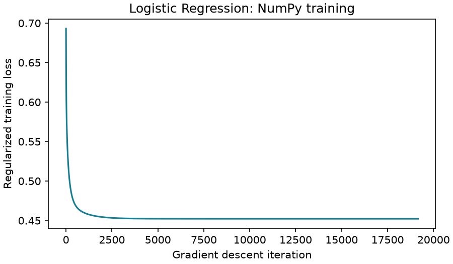

# Titanic Survival Prediction: Naive Bayes vs Logistic Regression

Both model notebooks show the scikit-learn estimator alongside a direct NumPy implementation. They share one preparation script and fixed train/test split, with executed results and graphs included.

## Layout

```text
titanic-survival-comparison/
|-- data/
|   |-- input/
|   |   |-- titanic.csv
|   |   `-- split.json
|   |-- output/
|   |   |-- metrics.md
|   |   |-- metrics.json
|   |   `-- graphs/
|   |       |-- naive_bayes_confusion_matrix.png
|   |       |-- logistic_regression_confusion_matrix.png
|   |       `-- logistic_regression_training_loss.png
|   `-- data_preparation.py
|-- models/
|   |-- naive_bayes.ipynb
|   `-- logistic_regression.ipynb
|-- .gitignore
|-- requirements.txt
`-- README.md
```

## Get the project

```bash
git clone https://github.com/ArnavGoel28/titanic-survival-comparison.git
cd titanic-survival-comparison
```

## Run

Use Python 3.12. Open this folder as the project root in VS Code or an existing Jupyter environment.

```powershell
py -3.12 -m venv .venv
.venv/Scripts/python.exe -m pip install -r requirements.txt
```

On macOS/Linux, use `python3.12 -m venv .venv` and `.venv/bin/python -m pip install -r requirements.txt`.

1. Select the `.venv` Python kernel.
2. Open `models/naive_bayes.ipynb` and run all cells.
3. Open `models/logistic_regression.ipynb` and run all cells.
4. Read [the shared metrics report](data/output/metrics.md).

Either notebook can run first. Run both again after changing preprocessing or estimator settings. Each notebook updates only its own entry in `metrics.json` and regenerates `metrics.md` from available results.

To check data preparation alone:

```powershell
.venv/Scripts/python.exe data/data_preparation.py
```

## Data and preparation

Source: [Kaggle Titanic competition](https://www.kaggle.com/competitions/titanic/data), subject to [competition rules](https://www.kaggle.com/competitions/titanic/rules). `data/input/titanic.csv` is the original labeled train.csv, renamed without changing its bytes. It contains 891 passengers, with 342 survivors and 549 non-survivors. Positive class: Survived=1. Kaggle's unlabeled competition test file and example predictions are not used.

SHA-256: `7d118fef8b6ccf7f81111877bc388536f7b1e498a655e3d649d19aaa010e9f6f`.

Both models use the same 712 training and 179 test passengers from `split.json`. Known ticket/family travel groups were kept together when this split was created. The fixed split was inspected in earlier development and is not presented as a new independent test.

Numeric predictors: Age, SibSp, Parch and Fare. Categorical predictors: Pclass, Sex and Embarked. Numeric gaps use training medians; category gaps use training modes. Categories and scaling are learned only from training records. No oversampling or parameter tuning is used. Numeric scaling and one-hot features are the same for both classifiers.

## Implementations

Each notebook keeps the original library model and adds a NumPy class with its own training and prediction methods.

- **Naive Bayes:** calculate class priors, per-class means and variances, Gaussian log-likelihoods, and normalized probabilities. A small variance floor handles constant features.
- **Logistic Regression:** calculate a stable sigmoid and optimize L2-regularized binary cross-entropy using full-batch gradient descent. The intercept is not penalized.

NumPy LR minimizes `mean(binary cross-entropy) + ||w||² / (2*C*n)`, matching the library's `C=1` objective. It uses learning rate 0.1, at most 50,000 iterations and a training-gradient tolerance of 1e-7. It converged in 19,158 iterations for this fixed input. The original library LR uses its default L-BFGS solver with `max_iter=1000`.

The added model logic uses NumPy directly. Scikit-learn remains responsible for preprocessing, evaluation metrics and confusion-matrix display.

## Results

| Model / implementation | Accuracy | F1 | ROC-AUC | Log-loss |
| --- | ---: | ---: | ---: | ---: |
| Naive Bayes (scikit-learn) | 78.77% | 0.720588 | 0.840885 | 0.654587 |
| Naive Bayes (NumPy) | 78.77% | 0.720588 | 0.840885 | 0.654587 |
| Logistic Regression (scikit-learn) | 80.45% | 0.736842 | 0.864997 | 0.434158 |
| Logistic Regression (NumPy) | 80.45% | 0.736842 | 0.864865 | 0.434034 |

The majority-class reference is 62.01% accurate. Both implementations of each model produce the same threshold-based predictions on these test records. Naive Bayes identifies 49 of the 68 survivors with 19 false positives; Logistic Regression identifies the same 49 survivors with 16 false positives.

The NumPy NB probabilities agree with the library within numerical precision. NumPy LR uses a different optimizer and a stricter training-gradient stopping rule; its probabilities and ranking metrics differ slightly from the library solution. These small differences do not establish that either implementation is superior. No test scores are used to choose optimizer settings.

Gaussian Naive Bayes's independence/Gaussian assumptions are approximate for mixed features; LR remains limited to linear log-odds. One historical sample cannot establish universal superiority.




## Supporting files

- `.gitignore` keeps environments and notebook caches out of the repository.
- `data/input/split.json` preserves identical, reproducible train/test records.
- `data/output/metrics.json` stores measured values so each notebook can update the combined Markdown report.

The source data remains subject to its own terms. Both notebooks and the shared report are reproducible using the included input version and fixed split.
