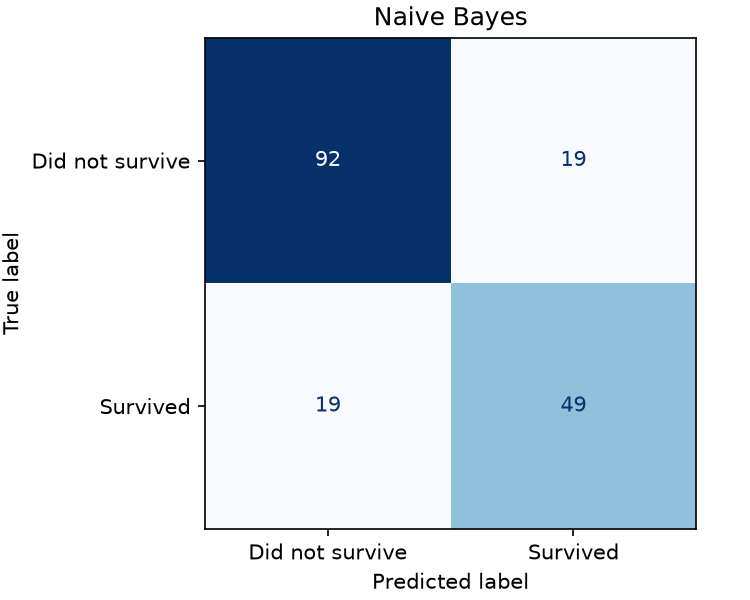
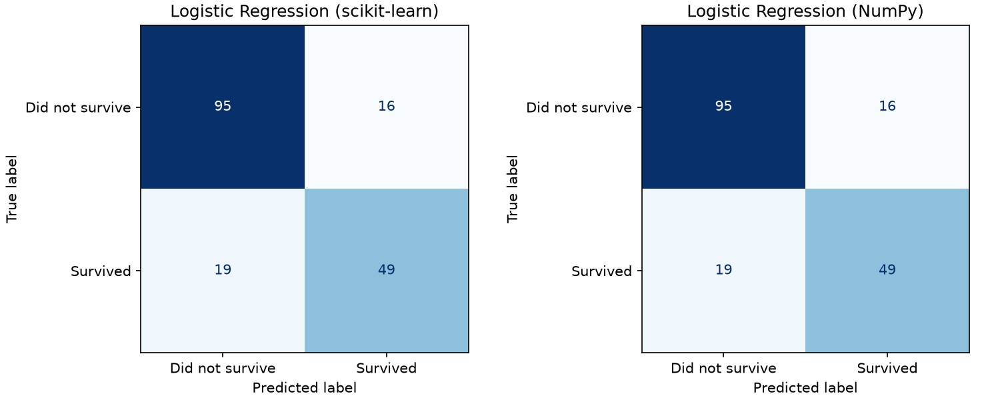

# Titanic Survival Prediction: Naive Bayes vs Logistic Regression

Two model notebooks share one data-preparation script and a fixed train/test split. Their executed outputs, test metrics and graphs are included.

## Layout

```text
titanic-survival-comparison/
|-- data/
|   |-- input/
|   |   |-- titanic.csv
|   |   `-- split.json
|   |-- output/
|   |   |-- metrics.md
|   |   |-- metrics.json
|   |   `-- graphs/
|   |       |-- naive_bayes_confusion_matrix.png
|   |       `-- logistic_regression_confusion_matrix.png
|   `-- data_preparation.py
|-- models/
|   |-- naive_bayes.ipynb
|   `-- logistic_regression.ipynb
|-- .gitignore
|-- requirements.txt
`-- README.md
```

## Get the project

```bash
git clone https://github.com/ArnavGoel28/titanic-survival-comparison.git
cd titanic-survival-comparison
```

## Run

Use Python 3.12. Open this folder as the project root in VS Code or an existing Jupyter environment.

```powershell
py -3.12 -m venv .venv
.venv/Scripts/python.exe -m pip install -r requirements.txt
```

On macOS/Linux, use `python3.12 -m venv .venv` and `.venv/bin/python -m pip install -r requirements.txt`.

1. Select the `.venv` Python kernel.
2. Open `models/naive_bayes.ipynb` and run all cells.
3. Open `models/logistic_regression.ipynb` and run all cells.
4. Read [the shared metrics report](data/output/metrics.md).

Either notebook can run first. Run both again after changing preprocessing or estimator settings. Each notebook updates only its own entry in `metrics.json` and regenerates `metrics.md` from available results.

To check data preparation alone:

```powershell
.venv/Scripts/python.exe data/data_preparation.py
```

## Data and preparation

Source: [Kaggle Titanic competition](https://www.kaggle.com/competitions/titanic/data), subject to [competition rules](https://www.kaggle.com/competitions/titanic/rules). `data/input/titanic.csv` is the original labeled train.csv, renamed without changing its bytes. It contains 891 passengers, with 342 survivors and 549 non-survivors. Positive class: Survived=1. Kaggle's unlabeled competition test file and example predictions are not used.

SHA-256: `7d118fef8b6ccf7f81111877bc388536f7b1e498a655e3d649d19aaa010e9f6f`.

Both models use the same 712 training and 179 test passengers from `split.json`. Known ticket/family travel groups were kept together when this split was created. The fixed split was inspected in earlier development and is not presented as a new independent test.

Numeric predictors: Age, SibSp, Parch and Fare. Categorical predictors: Pclass, Sex and Embarked. Numeric gaps use training medians; category gaps use training modes. Categories and scaling are learned only from training records. No oversampling or parameter tuning is used. Numeric scaling and one-hot features are the same for both classifiers.

## Results

| Model | Accuracy | F1 | ROC-AUC | Log-loss |
| --- | ---: | ---: | ---: | ---: |
| Naive Bayes | 78.77% | 0.7206 | 0.8409 | 0.6546 |
| Logistic Regression | 80.45% | 0.7368 | 0.8650 | 0.4342 |

The majority-class reference is 62.01% accurate. LR is slightly better on this split. Both models identify 49 of the 68 survivors; LR makes 16 false positives versus 19 for NB. GaussianNB's independence/Gaussian assumptions are approximate for these mixed features; LR remains limited to linear log-odds. One historical sample cannot establish universal superiority.





## Supporting files

- `.gitignore` keeps environments and notebook caches out of the repository.
- `data/input/split.json` preserves identical, reproducible train/test records.
- `data/output/metrics.json` stores measured values so each notebook can update the combined Markdown report.

The source data remains subject to its own terms. Both notebooks and the shared report are reproducible using the included input version and fixed split.
